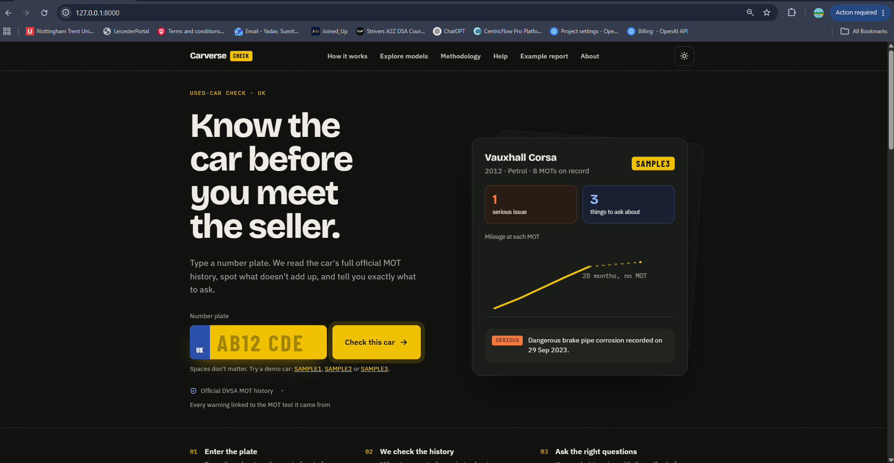
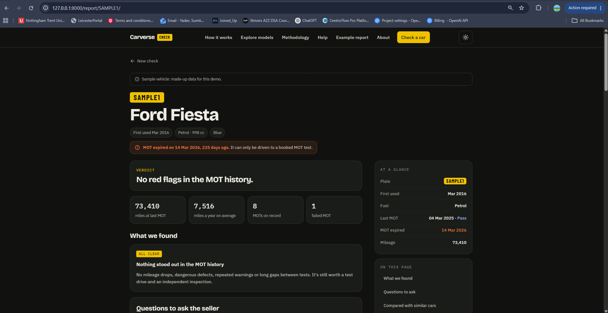
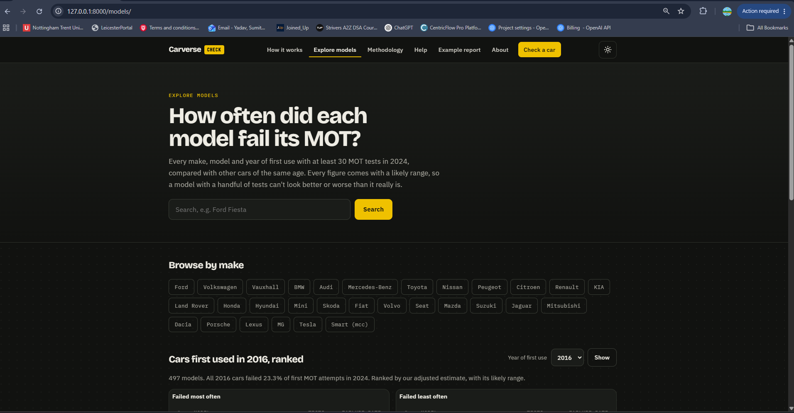
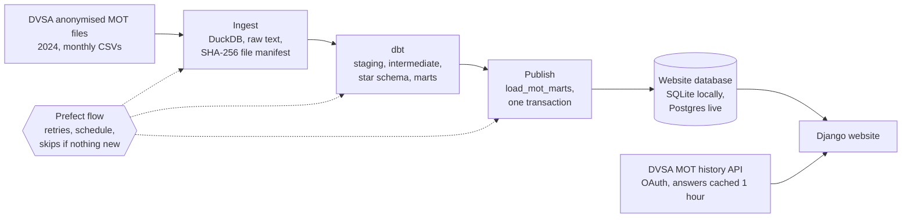

# Carverse Check

[](https://github.com/SumitYadav2003/carverse-check/actions/workflows/ci.yml)

A free used-car check for UK buyers. You type a number plate; it reads the car's official MOT history from DVSA, points out what doesn't add up, and compares the car with every other car of the same make, model and age, using statistics that don't let a small sample mislead you.

Behind the website is a data pipeline that cleans DVSA's anonymised record of every MOT test in Great Britain in 2024 (42.6 million tests), checks its own totals against DVSA's published statistics, and only publishes figures that pass every test.

<!-- Live site: add the link here once it's deployed -->

| Home | A report | Explore models |
|---|---|---|
|  |  |  |

## What a report shows

- **Four checks on the car's own history**: recorded mileage that went down, dangerous defects, the same advisory at more than one MOT, and gaps of more than about 14 months with no MOT. Every finding links to the MOT tests it came from.
- **MOT status**: whether the MOT is valid today and for how long.
- **Comparison with similar cars**: how often cars of the same make, model and year of first use failed their first MOT attempt, against all cars of that age. A simple scale shows where the model sits among all models of its age. Each rate has a likely range, small groups get an adjusted estimate, and the full funnel plot is one click away.
- **Mileage against similar cars**: the car's average miles a year, placed within the spread for its model and age.
- **Questions to ask the seller**: a printable checklist built from the car's findings, its latest advisories cross-referenced with the areas its model fails on more often, and the model's other weak spots.

There's also an Explore models section for browsing the statistics without a plate: search, rankings for each year of first use, and a page for every model showing how it did at each age.

## How it works



The per-car history is fetched live from the DVSA MOT history API. The comparisons come from the bulk data, which is processed on my laptop; only the small summary tables (17,460 make, model and year groups) are copied to the website.

### The pipeline

1. **Ingest** (`pipeline/ingest.py`) loads every file into DuckDB exactly as published, as text, and records a SHA-256 fingerprint of each file. Re-running skips files already loaded; a file DVSA republishes with changes is replaced in a single transaction.
2. **Transform** (`transform/`, dbt) cleans and types the data, removes duplicates and builds a star schema: `fct_mot_tests` (42,598,624 rows), `fct_test_defects` (91,829,954 rows), `dim_vehicle_model` and `dim_defect`. Mart tables then work out failure rates, ranges, adjusted estimates, funnel limits, defect categories and mileage spreads.
3. **Test**: 49 dbt data tests, a dbt unit test, and enforced contracts on the three tables the website reads. A failing test stops the run before anything is published.
4. **Publish** (`load_mot_marts`) replaces the website's copy of the marts in one transaction, so the site never shows a half-loaded state.
5. **Orchestrate** (`orchestration/flow.py`, Prefect) runs all of the above as one flow, with every dbt model and test visible as its own task, retries on the publish step, and an optional monthly schedule. If no file has changed, it skips the rebuild. A full run on the real data takes about seven and a half minutes on my laptop.

### Cleaning the data

The files needed more work than their user guide suggests. The header line repeats inside the data. About 35% of test result rows are exact copies of another row. 829,687 tests have copies that disagree with each other, mostly about vehicle details; where they disagree, the value is treated as unknown rather than guessed, and the test is flagged. A few values contain commas or backslash-escaped quotes that break naive CSV reading, so the file format is set explicitly and any unreadable line is set aside and counted.

### Checking against DVSA

If the cleaning were wrong, the totals wouldn't match DVSA's own published statistics. For cars and light vans, April to December 2024:

| | Ours | DVSA |
|---|---:|---:|
| Initial tests | 24,136,921 | 24,157,139 |
| Initial failure rate | 28.18% | 28.17% |
| Final failure rate | 22.73% | 22.72% |

A dbt test repeats this check for each quarter on every build.

### The statistics

A model with 40 tests can show a failure rate ten points away from its true value by chance alone, which is why raw league tables mislead. So every rate gets a Wilson score interval, small groups get an empirical Bayes estimate (pulled towards the rate for all cars of their age, strongly when they have few tests), and the funnel plots follow Spiegelhalter's method for comparing hospitals. A model is only called better or worse than its peers when the whole range of its adjusted estimate is on one side of the peer rate and the gap is at least one percentage point. The site's methodology page has the details and the references.

## Things the tests caught

A few decisions came from checks failing, and they're the parts of the project I'd most like to talk about:

- **A textbook setting that didn't fit.** Spiegelhalter's method clips extreme scores at the 10th and 90th percentiles before measuring how much models differ. In a simulation where the true spread was known, that halved the measured spread, which would have flagged far too many models as unusual. Clipping at 1% stayed within about 10% of the truth. The simulation is in `pipeline/check_spread_estimator.py`.
- **Two questions that looked like one.** On realistic data, a popular model at 31% against 25% for its peers came out as "not clearly different", because the funnel plot answers whether a model is an outlier among models, not whether it's worse than average. They're now two separate outputs.
- **A warehouse left locked.** dbt kept the DuckDB file open after building, so the publish step couldn't read it. The retries made the cause obvious; the flow now closes the connection explicitly.
- **Accessibility.** Automated axe checks in the browser tests found small grey text below the WCAG contrast minimum, and wide tables that keyboard users couldn't scroll on phones. Both are fixed, and the checks now run in light and dark themes at desktop and phone widths.
- **Python 3.14.** The plan was Dagster, but its dbt integration didn't support Python 3.14 yet, so the orchestration uses Prefect, which I tested on 3.14 before switching.

## Quality checks

Every push runs four GitHub Actions jobs:

| Job | What it does |
|---|---|
| Django tests | 87 unit tests, migration check, Django's production deployment check |
| Pipeline | Generates sample data with the same quirks as the real files, runs the Prefect flow, then runs it again and requires it to skip everything |
| Browser tests | 16 Playwright tests in Chromium, including axe accessibility checks on 12 pages |
| Lighthouse | Runs the site with production settings under gunicorn and fails below 95 for accessibility or 90 for best practices. The latest run scored 98 to 100 on every page tested |

## Tech

Python 3.14, Django 6.1, DuckDB, dbt (dbt-duckdb), Prefect, Playwright, axe-core, Lighthouse CI, GitHub Actions. The front end is plain HTML, CSS and JavaScript, works without JavaScript, and loads no third-party scripts, fonts or cookies.

## Running it locally

You need Python 3.14 and Git.

```
git clone https://github.com/SumitYadav2003/carverse-check.git
cd carverse-check
python -m venv venv
venv\Scripts\activate          # macOS/Linux: source venv/bin/activate
pip install -r requirements.txt
copy .env.example .env         # macOS/Linux: cp .env.example .env
python manage.py migrate
python manage.py runserver
```

Open http://127.0.0.1:8000 and try the demo cars `SAMPLE1`, `SAMPLE2` and `SAMPLE3`. They're made-up records, so no API access is needed. To look up real cars, [register for the DVSA MOT history API](https://documentation.history.mot.api.gov.uk/mot-history-api/register) and add the credentials to `.env`.

### Running the pipeline

```
pip install -r requirements-pipeline.txt
```

Download the 2024 files from [DVSA's anonymised MOT data page](https://open.data.dvsa.gov.uk/mot-anonymised/index.html) into `data/raw/2024/`, then:

```
python pipeline/profile_raw.py data/raw/2024     # unzips and profiles the files
python -m orchestration.flow run --force          # ingest, dbt build, publish
```

The comparison sections and Explore pages appear once the marts are loaded. To try the pipeline without the real data, `python pipeline/make_sample_data.py data/raw/sample` generates a small dataset in the same format.

To watch runs in Prefect's dashboard, start `prefect server start` in another terminal and set `PREFECT_API_URL=http://127.0.0.1:4200/api` before running the flow.

### Running the tests

```
python manage.py test checker                   # unit tests
pip install -r requirements-e2e.txt
python -m playwright install chromium
python manage.py test e2e                       # browser tests
```

## Project layout

```
checker/          Django app: checks, comparison, checklist, explore pages, DVSA client
config/           Django settings
e2e/              Playwright browser tests
orchestration/    Prefect flow
pipeline/         ingest, profiling, sample data, estimator simulation
transform/        dbt project: staging, intermediate, marts, tests, seed
```

## Data and licence

MOT data is from the Driver and Vehicle Standards Agency and contains public sector information licensed under the [Open Government Licence v3.0](https://www.nationalarchives.gov.uk/doc/open-government-licence/version/3/). This project isn't affiliated with or endorsed by DVSA. The figures describe models, not individual cars, and aren't advice to buy or avoid any vehicle.

## Author

Sumit Yadav, MSc Advanced Computer Science, University of Leicester. [LinkedIn](https://www.linkedin.com/in/yadavsumit2003) · [GitHub](https://github.com/SumitYadav2003)
